<div align="center">

# 🛒 Online Shoppers Purchasing Intention Prediction

### *An End-to-End Machine Learning Pipeline for Predicting Online Shopper Conversion Behavior*

[](https://www.python.org/)
[](https://scikit-learn.org/)
[](https://pandas.pydata.org/)
[](https://numpy.org/)
[](report/Online_Shoppers_Purchasing_Intention_Report.pdf)
[](https://opensource.org/licenses/MIT)
[](https://github.com/kumaradi9508/Online-Shoppers-ML-Project)

<p align="center">
  <a href="#-project-overview">Project Overview</a> •
  <a href="#-dataset-description">Dataset</a> •
  <a href="#-workflow--timeline">Workflow</a> •
  <a href="#-exploratory-data-analysis-eda">Key Insights & EDA</a> •
  <a href="#-machine-learning-models">Models & Results</a> •
  <a href="#-business-implications">Business Impact</a> •
  <a href="report/Online_Shoppers_Purchasing_Intention_Report.pdf"><b>📄 Project Report (PDF)</b></a> •
  <a href="#-installation--usage">Quickstart</a>
</p>

---

</div>

## 📌 Project Overview

In the highly competitive world of e-commerce, understanding user browsing intent in real-time is crucial for improving conversion rates, minimizing cart abandonment, and optimizing marketing spend.

This project delivers an **end-to-end Machine Learning solution** to analyze and predict whether an online browsing session will result in a purchase (`Revenue = True`). Built on **12,330 e-commerce browsing sessions**, this project implements rigorous data preprocessing, comprehensive exploratory data analysis (EDA), specialized feature scaling, and multi-model machine learning comparison (Logistic Regression, Gaussian Naive Bayes, K-Nearest Neighbors, and Decision Tree).

### 🎯 Key Objectives
1. **Analyze shopper navigation patterns** across Administrative, Informational, and Product pages.
2. **Evaluate the influence of temporal and behavioral factors** (Visitor Type, Month, Weekend, and Special Day proximity).
3. **Handle severe class imbalance** (~84.4% non-purchasers vs. ~15.6% purchasers) through stratified sampling.
4. **Benchmark multiple classification models** against critical evaluation metrics (Accuracy, Precision, Recall, and F1-Score).
5. **Formulate actionable business strategies** to maximize online revenue.

---

## 📊 Dataset Description

The dataset consists of **12,330 customer sessions** collected over a 1-year period, representing unique visitor interactions to prevent session bias.

* **Source:** Online Shoppers Purchasing Intention Dataset (UCI Machine Learning Repository)
* **Target Feature:** `Revenue` (`True` = Purchase completed, `False` = No purchase)
* **Dimensions:** 12,330 rows × 18 attributes (10 numerical, 8 categorical)

### Feature Breakdown

| Category | Attribute | Description | Data Type |
| :--- | :--- | :--- | :--- |
| **Page Navigation** | `Administrative` | Number of administrative pages visited | Integer |
| | `Administrative_Duration` | Total time spent on administrative pages (seconds) | Float |
| | `Informational` | Number of informational pages visited | Integer |
| | `Informational_Duration` | Total time spent on informational pages (seconds) | Float |
| | `ProductRelated` | Number of product pages visited | Integer |
| | `ProductRelated_Duration` | Total time spent on product pages (seconds) | Float |
| **Google Analytics** | `BounceRates` | Percentage of visitors who enter and leave from that page without further interaction | Float |
| | `ExitRates` | Percentage of pageviews that were the last in the session | Float |
| | `PageValues` | Average value of the page that a user visited before completing a transaction | Float |
| **Calendar & Context** | `SpecialDay` | Closeness of the browsing date to a specific special day (e.g., Mother's Day, Valentine's Day) | Float (0.0 to 1.0) |
| | `Month` | Month of the browsing session (Feb – Dec) | Categorical |
| | `Weekend` | Indicator whether the session occurred on a weekend | Boolean |
| **User & Source** | `OperatingSystems` | Operating system ID used by visitor | Categorical / Int |
| | `Browser` | Browser ID used by visitor | Categorical / Int |
| | `Region` | Geographic region ID of visitor | Categorical / Int |
| | `TrafficType` | Traffic acquisition source ID (direct, search, banner, etc.) | Categorical / Int |
| | `VisitorType` | Type of visitor: `Returning_Visitor`, `New_Visitor`, `Other` | Categorical |
| **Target** | `Revenue` | Target: Whether a transaction was completed | Boolean |

---

## 🗓️ Workflow & Methodology

The project follows a structured 6-phase engineering lifecycle:

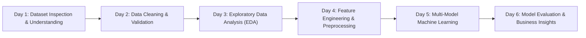

* **Day 1: Dataset Understanding:** Audited schema, verified 0 missing values, analyzed data types, and documented the natural target imbalance (84.37% non-purchasing vs. 15.63% purchasing).
* **Day 2: Data Cleaning & Preprocessing:** Identified and purged 125 duplicate records (12,330 → 12,205 rows). Validated boundary conditions (no negative durations, bounce/exit rates bounded within $[0, 1]$).
* **Day 3: Exploratory Data Analysis:** Conducted statistical aggregation and produced 6 high-resolution analytical charts evaluating duration, seasonality, user loyalty, and weekend behavior.
* **Day 4: Feature Preparation:** Encoded categorical features via one-hot encoding (`pd.get_dummies(..., drop_first=True)`), split dataset using 75% train / 25% test stratified sampling (`stratify=y`), and applied model-appropriate scaling:
  * **StandardScaler:** For gradient-based Logistic Regression.
  * **MinMaxScaler:** For distance-based K-Nearest Neighbors.
* **Day 5: Machine Learning Implementation:** Built, fitted, and evaluated 4 classifiers: Logistic Regression, Gaussian Naive Bayes, KNN ($k=5$), and Decision Tree (Entropy criterion with tree visualization).
* **Day 6: Model Comparison & Benchmarking:** Synthesized comprehensive comparison tables and generated visualization charts evaluating trade-offs across Accuracy, Precision, Recall, and F1-Score.

---

## 📈 Exploratory Data Analysis (EDA)

### 1. Purchase Class Imbalance
The dataset displays a pronounced imbalance: **10,297 sessions (84.37%)** resulted in no purchase, while **1,908 sessions (15.63%)** generated revenue. This informed our metric selection (prioritizing Recall, Precision, and F1-Score over raw accuracy).

<p align="center">
  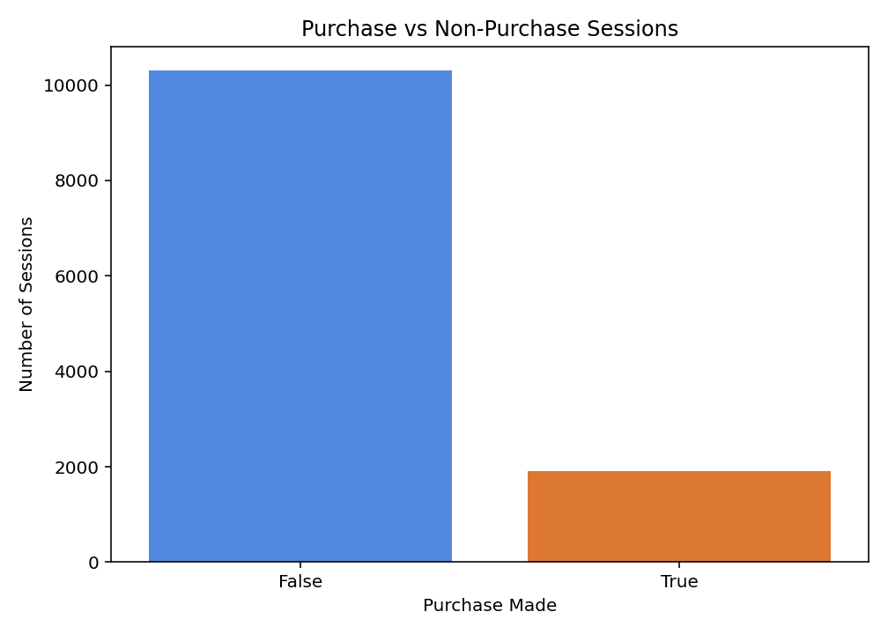
</p>

---

### 2. Visitor Loyalty vs. Conversion
Surprisingly, **New Visitors** convert at a rate of **24.93%**, compared to only **14.09%** for **Returning Visitors**. New visitors frequently arrive with high immediate purchase intent (targeted campaigns or specific product searches), while returning visitors browse casually or check for updates.

<p align="center">
  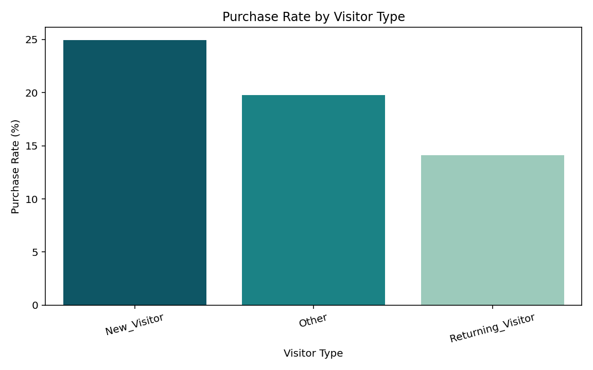
</p>

---

### 3. Browsing Duration Dynamics
Shoppers who complete transactions spend significantly longer exploring the catalog:
* **Product-Related Duration:** Non-purchasers averaged **1,082.98s (~18 mins)**, whereas purchasers averaged **1,876.21s (~31.3 mins)** — a **73.2% increase**.
* **Administrative Duration:** Increased from **74.64s** (non-purchasers) to **119.48s** (purchasers).
* **Informational Duration:** Increased from **30.60s** (non-purchasers) to **57.61s** (purchasers).

<p align="center">
  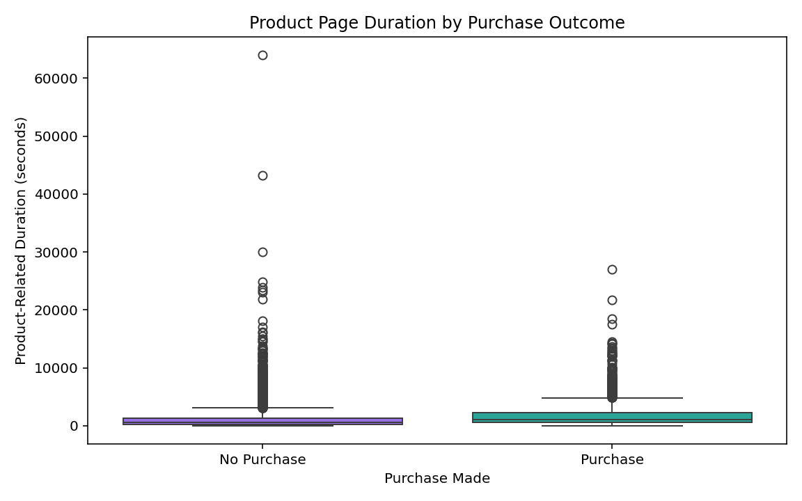
</p>

---

### 4. Seasonality & Monthly Conversion Trends
Conversion rates peak dramatically in **November (25.49%)**, followed by **October (20.95%)** and **September (19.20%)**, aligning with major global retail surges like Black Friday and early holiday shopping. In contrast, **February recorded the lowest conversion rate (1.66%)**.

<p align="center">
  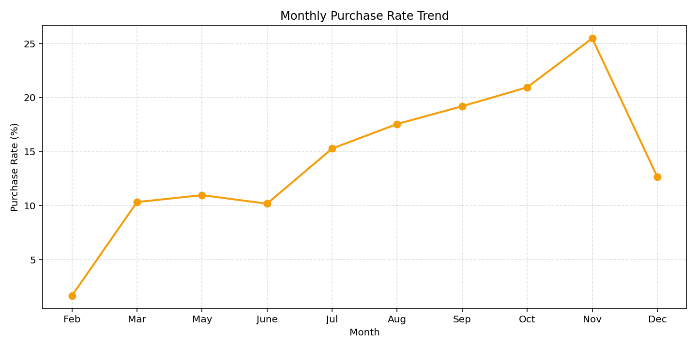
</p>

---

### 5. Weekend vs. Weekday Purchasing
Shoppers exhibit higher conversion tendencies on weekends (**17.45%**) compared to weekdays (**15.08%**), indicating that users have more leisure time to research and complete transactions during weekends.

<p align="center">
  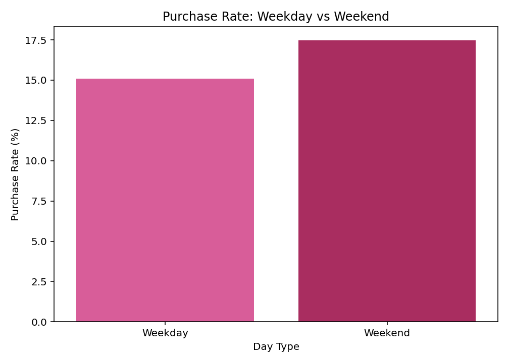
</p>

---

### 6. Proximity to Special Days
Sessions with `SpecialDay = 0.0` (normal days) converted at **16.71%**, whereas sessions occurring on or immediately preceding a special day showed lower conversion rates (e.g., 3.40% at 0.8 and 6.49% at 1.0). This suggests that users close to holidays often face shipping cutoff anxiety or browse last-minute without committing online.

<p align="center">
  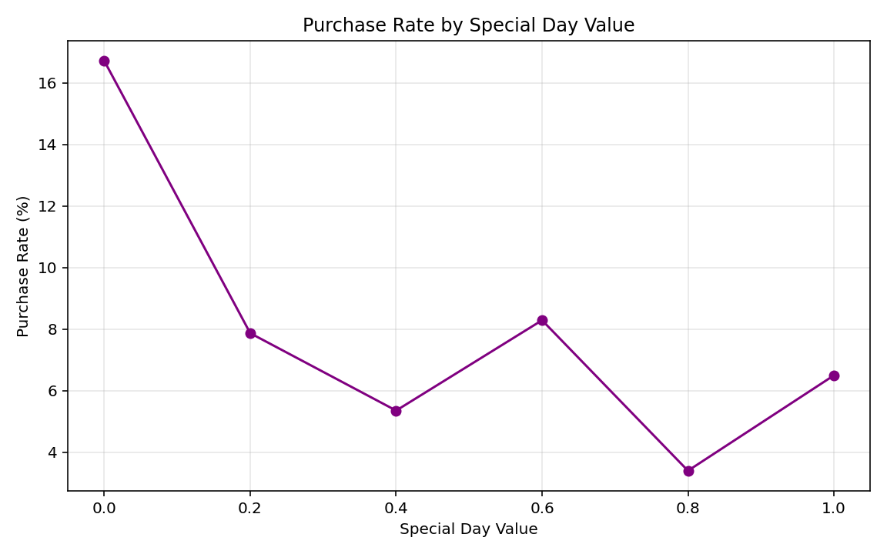
</p>

---

## 🤖 Machine Learning Models & Results

Four diverse algorithms were trained and evaluated on an independent test set of **3,052 sessions** (stratified split with 477 purchases and 2,575 non-purchases):

### 📋 Model Comparison Summary

| Model | Accuracy | Precision | Recall | F1-Score | Primary Advantage |
| :--- | :---: | :---: | :---: | :---: | :--- |
| 🥇 **Logistic Regression** | **88.93%** | **77.25%** | 41.30% | 53.83% | **Highest Accuracy & Precision** (minimal false positives) |
| 🥈 **Decision Tree** | 86.07% | 55.35% | 56.39% | **55.87%** | **Highest F1-Score** & transparent interpretability |
| 🥉 **Gaussian Naive Bayes** | 80.93% | 42.47% | **62.05%** | 50.43% | **Highest Recall** (catches the most buyers) |
| 🔹 **K-Nearest Neighbors (KNN)** | 84.80% | 53.80% | 19.29% | 28.40% | Distance baseline ($k=5$, Euclidean) |

<p align="center">
  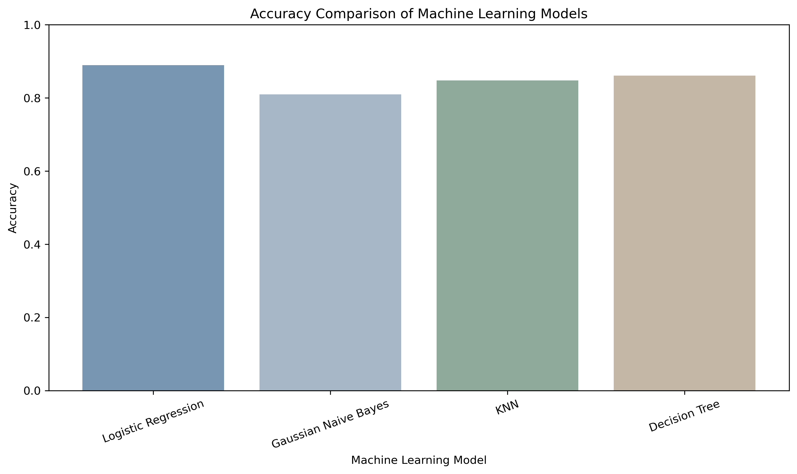
</p>

---

### 🔍 Confusion Matrix Analysis

The confusion matrices illustrate how each model navigates the precision-recall trade-off under class imbalance:

<table align="center">
  <tr>
    <td align="center"><b>Logistic Regression</b></td>
    <td align="center"><b>Gaussian Naive Bayes</b></td>
    <td align="center"><b>K-Nearest Neighbors</b></td>
  </tr>
  <tr>
    <td>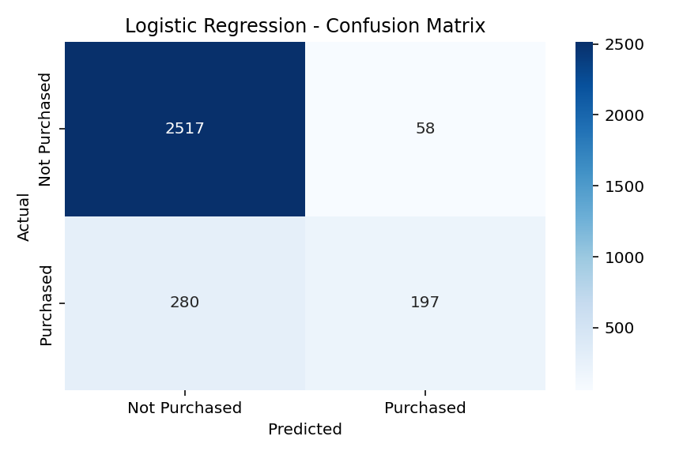</td>
    <td>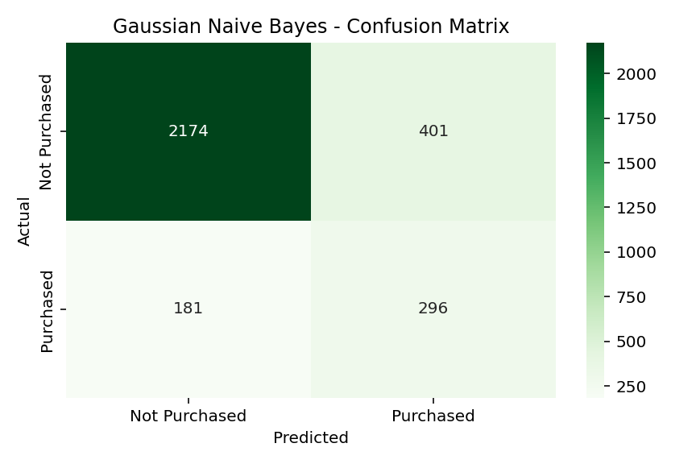</td>
    <td>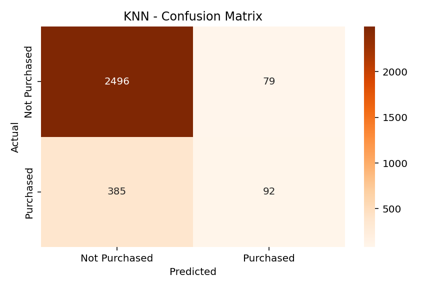</td>
  </tr>
</table>

### 🌲 Decision Tree Interpretability
The Decision Tree classifier provides clear, rule-based splits. Key determinants include `PageValues` (the single most decisive feature for conversion), followed by `ProductRelated_Duration` and `ExitRates`.

<p align="center">
  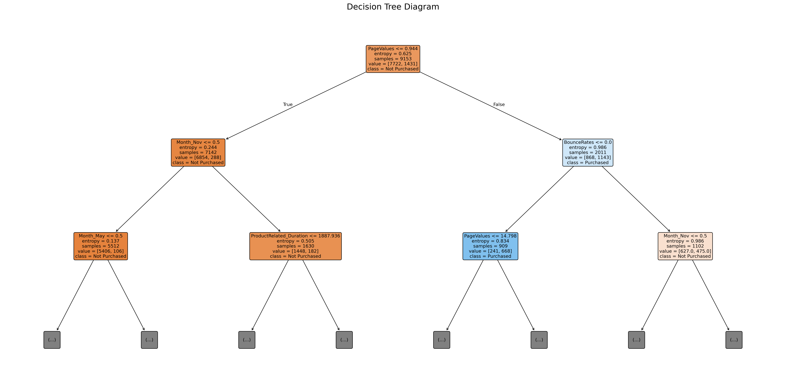
</p>

---

## 💡 Business Implications & Recommendations

1. **Targeted Real-Time Interventions:**
   * **Logistic Regression (High Precision - 77.25%):** Best suited for high-cost interventions (e.g., offering instant $10-$20 discount coupons or free shipping codes). Its high precision ensures marketing budget is not squandered on users who wouldn't buy anyway.
   * **Gaussian Naive Bayes (High Recall - 62.05%):** Ideal for low-cost automated nudges (e.g., exit-intent popups, personalized email reminders, or social proof banners like *"3 items left in stock"*), capturing over 62% of all potential buyers.

2. **Capitalize on New Visitors:**
   * Since new visitors boast a **24.9% conversion rate**, streamline first-time checkout flows (guest checkout, 1-click payments, streamlined registration) to minimize drop-off.

3. **Seasonality Readiness (Q4 Strategy):**
   * November and October deliver peak conversion rates (>20%). Infrastructure, server scalability, inventory management, and ad budgets should be heavily weighted towards these months.

4. **Product Page Engagement:**
   * Buyers spend **over 31 minutes** on product pages compared to 18 minutes for non-buyers. Implement rich media (360° product views, customer reviews, clear specs) to keep high-intent shoppers engaged.

---

## 📁 Repository Structure

```plaintext
Online-Shoppers-ML-Project/
├── data/
│   ├── online_shoppers_intention.csv            # Raw dataset (12,330 records)
│   └── online_shoppers_intention_cleaned.csv    # Cleaned dataset (12,205 records)
├── output/
│   ├── figures/                                 # Generated analytical charts
│   │   ├── decision_tree.png
│   │   ├── duration_analysis.png
│   │   ├── knn_cm.png
│   │   ├── logistic_regression_cm.png
│   │   ├── model_accuracy_comparison.png
│   │   ├── month_purchase_rate.png
│   │   ├── naive_bayes_cm.png
│   │   ├── purchase_analysis.png
│   │   ├── specialday_purchase_rate.png
│   │   ├── visitor_purchase_rate.png
│   │   └── weekend_purchase_rate.png
│   └── results/                                 # Exported statistical CSV tables
│       ├── cleaning_summary.csv
│       ├── day4_split_summary.csv
│       ├── duration_analysis.csv
│       ├── model_comparison.csv
│       ├── month_purchase_rate.csv
│       ├── purchase_analysis.csv
│       ├── specialday_purchase_rate.csv
│       ├── visitor_purchase_rate.csv
│       └── weekend_purchase_rate.csv
├── report/                                      # Academic & technical project report
│   └── Online_Shoppers_Purchasing_Intention_Report.pdf  # Comprehensive 47-page technical research report
├── screenshot/                                  # Application / notebook previews
├── src/
│   └── online_shopping_project.py               # Complete end-to-end Python script
├── .gitignore                                   # Standard Python gitignore
├── README.md                                    # Project documentation
└── requirements.txt                             # Python dependencies
```

---

## 🚀 Installation & Usage

### 1. Clone the Repository
```bash
git clone https://github.com/kumaradi9508/Online-Shoppers-ML-Project.git
cd Online-Shoppers-ML-Project
```

### 2. Set Up a Virtual Environment
```bash
# Windows
python -m venv venv
venv\Scripts\activate

# macOS / Linux
python3 -m venv venv
source venv/bin/activate
```

### 3. Install Dependencies
```bash
pip install -r requirements.txt
```

### 4. Execute the Pipeline
Run the complete end-to-end machine learning script:
```bash
python src/online_shopping_project.py
```
*The script will load data, perform cleaning, output figures to `output/figures/`, and save metric tables in `output/results/`.*

---

## 🛠️ Tech Stack

* **Language:** Python 3.8+
* **Data Manipulation:** [Pandas](https://pandas.pydata.org/), [NumPy](https://numpy.org/)
* **Machine Learning:** [Scikit-Learn](https://scikit-learn.org/) (LogisticRegression, GaussianNB, KNeighborsClassifier, DecisionTreeClassifier)
* **Visualization:** [Matplotlib](https://matplotlib.org/), [Seaborn](https://seaborn.pydata.org/)
* **Version Control:** Git, GitHub

---

## 👨‍💻 Author

**Aditya Kumar**
* **GitHub:** [@kumaradi9508](https://github.com/kumaradi9508)
* **Project Repository:** [Online-Shoppers-ML-Project](https://github.com/kumaradi9508/Online-Shoppers-ML-Project)

---

## 📜 License

This project is licensed under the [MIT License](LICENSE) — feel free to use and modify for personal and commercial applications.
